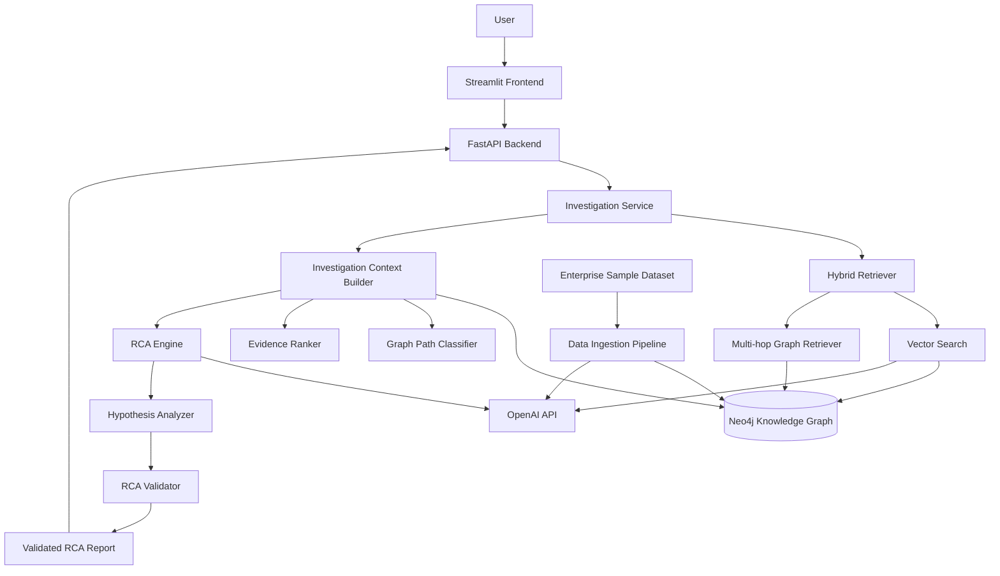
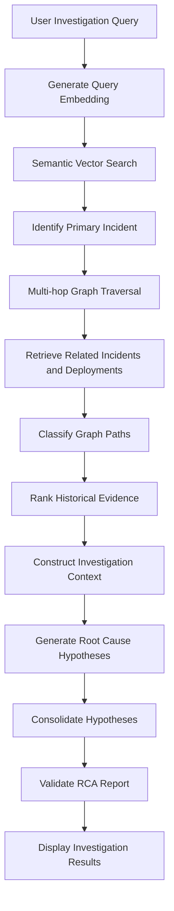
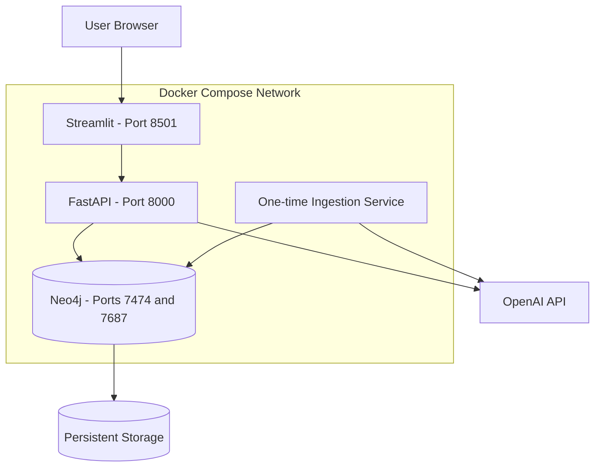

# Enterprise Incident Root Cause Analysis Assistant

An AI-powered enterprise incident investigation system that leverages Graph Retrieval-Augmented Generation (GraphRAG), Knowledge Graphs, semantic search and Large Language Models to identify potential root causes of incidents in distributed systems.

**Authors:** Badal Baidya & Mayur Chitte

## 1. Project Overview

Modern enterprise applications consist of interconnected microservices, databases, messaging systems and infrastructure components. Investigating incidents across these distributed systems requires analyzing service dependencies, historical incidents, deployment changes and operational documentation.

Traditional keyword-based search and conventional RAG approaches may fail to capture complex relationships between enterprise components.

This project combines vector-based semantic retrieval with multi-hop knowledge graph traversal to construct a comprehensive investigation context and generate evidence-backed root cause hypotheses.

The system assists engineers in incident investigation rather than claiming to automatically establish definitive root causes.

## 2. Key Features

- Enterprise knowledge graph using Neo4j.
- Semantic search using OpenAI embeddings.
- Hybrid retrieval combining vector search and graph traversal.
- Multi-hop service dependency analysis.
- Historical incident correlation.
- Deployment and incident timeline construction.
- Graph path classification.
- Heuristic evidence ranking.
- LLM-based root cause hypothesis generation.
- Hypothesis consolidation and validation.
- Confidence assessment and evidence traceability.
- Service impact classification.
- Recommended investigation and validation steps.
- REST API using FastAPI.
- Interactive investigation interface using Streamlit.
- Docker Compose-based deployment configuration.

## 3. System Architecture



## 4. Technology Stack

| Component | Technology |
|---|---|
| Programming language | Python 3.12 |
| Graph database | Neo4j 5.26 |
| Vector database | Neo4j Vector Index |
| Embedding model | text-embedding-3-small |
| Embedding dimensions | 1536 |
| Large language model | GPT-4o-mini |
| Backend framework | FastAPI |
| Frontend framework | Streamlit |
| Data validation | Pydantic v2 |
| Containerization | Docker |
| Container orchestration | Docker Compose |
| Dataset formats | JSON and Markdown |

## 5. Enterprise Knowledge Graph

The knowledge graph represents enterprise application components, operational events and their relationships.

### Entity Types

| Entity | Description |
|---|---|
| Service | Enterprise microservice |
| Database | Database dependency |
| KafkaTopic | Messaging infrastructure |
| Team | Service ownership |
| Incident | Historical operational incident |
| Deployment | Application deployment or configuration change |
| Error | Observed error signature |
| Runbook | Operational troubleshooting documentation |
| DocumentChunk | Searchable document content |

### Relationship Types

| Relationship | Source | Target |
|---|---|---|
| DEPENDS_ON | Service | Service |
| USES | Service | Database |
| PRODUCES | Service | KafkaTopic |
| CONSUMES | Service | KafkaTopic |
| OWNED_BY | Service | Team |
| AFFECTED | Incident | Service |
| OBSERVED | Incident | Error |
| ASSOCIATED_WITH | Incident | Deployment |
| DEPLOYED_TO | Deployment | Service |
| MENTIONS | DocumentChunk | Enterprise entity |

## 6. Investigation Workflow



## 7. Project Directory Structure

```text
incident-rag-assistant/
├── app/
│   ├── api/
│   ├── config/
│   ├── database/
│   ├── ingestion/
│   ├── investigation/
│   ├── models/
│   ├── retrieval/
│   ├── scripts/
│   └── main.py
│
├── frontend/
│   └── streamlit_app.py
│
├── data/
├── tests/
│
├── Dockerfile.backend
├── Dockerfile.frontend
├── docker-compose.yml
├── requirements.txt
├── .dockerignore
├── .gitignore
├── .env.example
└── README.md
```

## 8. Prerequisites

Before running the application, ensure the following are available:

- Docker Engine or Docker Desktop.
- Docker Compose V2.
- Git.
- Valid OpenAI API key.
- Internet connectivity for OpenAI API requests and downloading container images.
- Sufficient OpenAI API credits for embedding generation and RCA requests.

Python installation is not required on the host machine when using Docker Compose.

## 9. Environment Configuration

Navigate to the project root directory and create the environment configuration file.

```bash
cp .env.example .env
```

Update `.env` with the appropriate credentials and configuration.

```properties
NEO4J_URI=bolt://localhost:7687
NEO4J_USERNAME=neo4j
NEO4J_PASSWORD=your_password_here
NEO4J_DATABASE=neo4j

OPENAI_API_KEY=your_openai_api_key_here

EMBEDDING_MODEL=text-embedding-3-small
EMBEDDING_DIMENSION=1536

NEO4J_DATA_PATH=./neo4j-data
```

Docker Compose overrides the Neo4j connection URI for container-to-container communication.

Never commit the `.env` file or actual credentials to source control.

## 10. Docker Compose Deployment

The application consists of four containerized services.

| Service | Responsibility |
|---|---|
| neo4j | Knowledge graph and vector storage |
| backend | FastAPI and investigation engine |
| frontend | Streamlit user interface |
| ingestion | One-time knowledge graph initialization |



### 10.1 Validate Docker Compose Configuration

```bash
docker compose config --quiet
```

### 10.2 Build Application Images

```bash
docker compose build
```

### 10.3 Start Neo4j

```bash
docker compose up -d neo4j
```

### 10.4 Initialize the Knowledge Graph

For a fresh installation, execute the ingestion service.

```bash
docker compose run --build --rm ingestion
```

The ingestion service performs the following operations:

1. Initialize Neo4j schema and constraints.
2. Create the vector index.
3. Ingest structured enterprise entities.
4. Create knowledge graph relationships.
5. Load and chunk Markdown documents.
6. Generate and store document embeddings.
7. Link document chunks with enterprise entities.

This operation requires a valid OpenAI API key and sufficient API credits.

The ingestion pipeline does not need to be executed during every application restart.

### 10.5 Start the Application

```bash
docker compose up -d --build
```

### 10.6 Verify Container Status

```bash
docker compose ps
```

### 10.7 View Application Logs

```bash
docker compose logs -f
```

## 11. Accessing the Application

| Component | URL |
|---|---|
| Streamlit UI | http://localhost:8501 |
| FastAPI Swagger UI | http://localhost:8000/docs |
| Backend Health Check | http://localhost:8000/health |
| Neo4j Browser | http://localhost:7474 |

## 12. REST API

### Run an Investigation

**Endpoint**

```http
POST /api/investigations
```

**Request**

```json
{
  "query": "Why are payment requests timing out?",
  "top_k": 5,
  "max_hops": 3
}
```

### Request Parameters

| Parameter | Description | Default |
|---|---|---|
| query | Natural language investigation question | Required |
| top_k | Number of vector search results | 5 |
| max_hops | Maximum graph traversal depth | 3 |

### Example cURL Request

```bash
curl -X POST "http://localhost:8000/api/investigations" \
  -H "Content-Type: application/json" \
  -d '{
    "query": "Why are payment requests timing out?",
    "top_k": 5,
    "max_hops": 3
  }'
```

### Response Components

The investigation API returns:

- Primary incident identifier.
- Investigation context summary.
- Incident summary.
- Root cause hypotheses.
- Confidence levels and reasoning.
- Supporting and missing evidence.
- Related services, databases and deployments.
- Service impact classification.
- Recommended investigation steps.
- Incident and deployment timeline.
- Ranked historical evidence.
- Related incidents.
- Validation warnings and caveats.

## 13. Sample Investigation Queries

The following queries can be used to explore the application:

```text
Why are payment requests timing out?
```

```text
What caused the Customer Database connection pool exhaustion?
```

```text
Why is the Payment Service experiencing retry storms?
```

```text
What caused the Fraud Database deadlocks?
```

```text
Why is customer profile lookup latency increasing?
```

## 14. Sample Investigation Scenario

### Payment API Elevated Timeout Rate

The investigation identifies incident `INC-102` as the primary incident and explores its relationship with the Customer Service and historical incidents.

The following graph path represents a relevant dependency chain:

```text
INC-102
    |
    AFFECTED
    |
Payment Service
    |
    DEPENDS_ON
    |
Customer Service
    |
    USES
    |
Customer Database
```

The system identifies Customer Service degradation associated with connection pool exhaustion as a potential contributing factor.

It also evaluates historical payment retry incidents and relevant deployment changes.

The generated report distinguishes between observed evidence, potential root causes and additional information required to validate the hypotheses.

## 15. Evidence Ranking

Historical incidents are ranked using a heuristic scoring mechanism.

| Ranking Factor | Maximum Score |
|---|---:|
| Graph relevance | 3 |
| Symptom similarity | 3 |
| Temporal relevance | 4 |
| Direct incident relationship | 3 |
| Evidence specificity | 2 |
| Total | 15 |

The ranking score represents investigation relevance and should not be interpreted as the probability that an incident caused another incident.

## 16. RCA Validation

The application validates LLM-generated root cause hypotheses against the retrieved investigation context.

Validation includes:

- Verification of evidence identifiers.
- Verification of referenced services.
- Verification of database references.
- Verification of deployment references.
- Consolidation of overlapping hypotheses.
- Conservative confidence adjustment.
- Identification of missing supporting evidence.
- Generation of validation warnings.
- Separation of directly impacted services and suspected contributors.

Temporal correlation and graph connectivity alone are not considered proof of causality.

## 17. Running Without Docker Compose

For local development, the backend and frontend can also be executed directly using a Python virtual environment.

### Create a Virtual Environment

```bash
python3 -m venv .venv
source .venv/bin/activate
```

### Install Dependencies

```bash
python -m pip install -r requirements.txt
```

### Start Neo4j

Ensure that a Neo4j 5.26 instance is running and that the connection details are configured in `.env`.

For a fresh database, execute the initialization scripts in sequence:

```bash
python -m app.scripts.init_db
python -m app.scripts.init_vector_index
python -m app.scripts.ingest_structured_data
python -m app.scripts.ingest_relationships
python -m app.scripts.ingest_documents
python -m app.scripts.ingest_embeddings
python -m app.scripts.link_entities
```

### Start FastAPI

```bash
python -m uvicorn app.main:app --reload --port 8000
```

### Start Streamlit

Open a separate terminal, activate the virtual environment and execute:

```bash
python -m streamlit run frontend/streamlit_app.py
```

## 18. Docker Management Commands

| Operation | Command |
|---|---|
| Build images | `docker compose build` |
| Start application | `docker compose up -d` |
| Stop application | `docker compose stop` |
| Restart application | `docker compose restart` |
| Rebuild application | `docker compose up -d --build` |
| Container status | `docker compose ps` |
| Backend logs | `docker compose logs -f backend` |
| Frontend logs | `docker compose logs -f frontend` |
| Neo4j logs | `docker compose logs -f neo4j` |
| Run ingestion | `docker compose run --rm ingestion` |
| Remove containers | `docker compose down` |

Neo4j data is stored in a persistent host directory and is retained when containers are stopped or removed.

Do not delete the persistent data directory unless a complete database reset is intended.

## 19. Security Considerations

- Store credentials in environment variables.
- Never commit API keys or database passwords.
- Exclude sensitive files from Docker build contexts.
- Protect Neo4j persistent storage.
- Use synthetic enterprise data for demonstration.
- Restrict exposed application ports when deploying outside a local development environment.
- Introduce authentication and authorization before production deployment.

## 20. Limitations

- The application uses a synthetic enterprise dataset.
- Root cause hypotheses require human verification.
- Real-time operational telemetry is not currently integrated.
- Evidence ranking uses heuristic scoring.
- Graph traversal depth is bounded.
- LLM responses may vary between executions.
- Deployment correlation does not establish causality.
- Confidence validation is rule-based.
- Production-grade authentication and authorization are outside the current scope.
- Comprehensive automated testing and performance benchmarking remain future work.

## 21. Future Enhancements

- Integration with Prometheus and Grafana.
- Distributed tracing integration using OpenTelemetry.
- Real-time application log ingestion.
- Integration with incident management platforms.
- Automated knowledge graph updates.
- Agent-based investigation workflows.
- Advanced evidence reranking.
- Telemetry-backed causal analysis.
- Role-based access control.
- Comprehensive GraphRAG evaluation framework.
- Production deployment using Kubernetes.

## 22. Conclusion

The Enterprise Incident Root Cause Analysis Assistant demonstrates how knowledge graphs, semantic retrieval, multi-hop reasoning and Large Language Models can be combined to support enterprise incident investigations.

The system provides structured, evidence-backed root cause hypotheses while maintaining transparency regarding confidence, missing evidence and investigation limitations.

## 23. References

- Neo4j Documentation: https://neo4j.com/docs/
- Neo4j Cypher Manual: https://neo4j.com/docs/cypher-manual/current/
- OpenAI API Documentation: https://platform.openai.com/docs/
- FastAPI Documentation: https://fastapi.tiangolo.com/
- Streamlit Documentation: https://docs.streamlit.io/
- Pydantic Documentation: https://docs.pydantic.dev/
- Docker Documentation: https://docs.docker.com/
